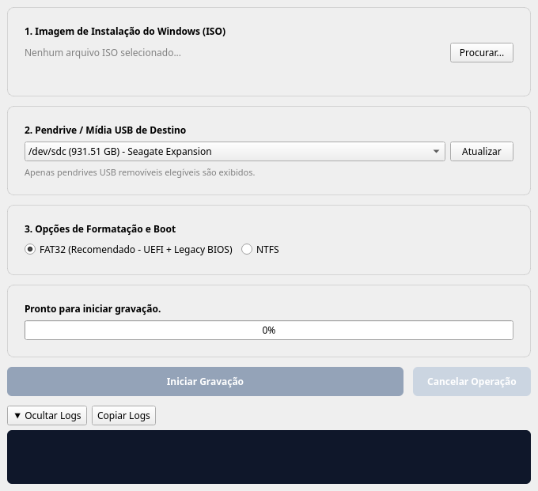

# WoeUSB-GUI (Windows Bootable USB Flasher)

A Linux desktop application built with Python and **PySide6 / Qt 6** for creating bootable Windows installation USB drives from official ISO images. Targets all major distributions (Arch Linux, Fedora, Ubuntu, Debian, BigLinux, Manjaro) and is packaged as a **Flatpak** (`org.woeusb.WoeUsbGui`).

[](LICENSE)


🌐 **Language**: **English** | [Português (Brasil)](README.pt-BR.md)

> [!NOTE]
> WoeUSB-GUI is **not yet available on Flathub**. See [docs/FLATHUB.md](docs/FLATHUB.md) for the submission status and the open items that must be resolved first.

---

## 📸 Interface



---

## ✨ Features

### Drive safety
- Device discovery through the host **UDisks2** D-Bus service, with `lsblk` as fallback.
- Only **removable USB drives ≥ 2 GB** are listed. Internal disks, swap and any disk holding a system mount point (`/`, `/boot`, `/home`, …) are never shown.
- **Large-drive filter** — *"Hide large drives (> 64 GB)"* is **enabled by default** and hides drives larger than 64 GiB (68.7 GB), so external backup HDDs/SSDs are not offered by accident. Untick it to show them.
- **Same-disk collision check** — if the selected ISO lives on the same physical disk as the target (any partition of it, symlinks resolved), the *Start* button is disabled with an explanation. The check runs again right before any unmount/format step.
- Explicit confirmation dialog showing vendor, model, capacity and device path before anything is erased.

### Writing
- ISO contents are extracted in user space with `7z` (p7zip) — no `mount -o loop`, no root.
- FAT32 target with the standard UEFI layout (`/efi/boot/bootx64.efi`).
- `install.wim` files larger than 4 GB are split into `.swm` parts with `wimlib-imagex split`, so the drive stays FAT32 / UEFI Secure Boot compatible.

### Interface
- All long operations run in a dedicated `QThread` worker; the UI stays responsive.
- Progress bar, current phase, speed estimate, and an expandable log panel with copy-to-clipboard.
- Safe cancellation: child processes are terminated and the target is unmounted cleanly.

---

## 🚀 Installation & Usage

### 1. Build and run the Flatpak locally

The manifest uses the KDE 6.6 runtime and bundles PySide6 6.6.3 wheels (x86_64).

```bash
# KDE 6.6 runtime and SDK
flatpak install flathub org.kde.Platform//6.6 org.kde.Sdk//6.6

# Build and install into the user installation
flatpak-builder --force-clean --user --install build-dir org.woeusb.WoeUsbGui.yml

# Run
flatpak run org.woeusb.WoeUsbGui
```

> [!TIP]
> If the build fails with `fuse: mount failed` (containers, restricted environments), add `--disable-rofiles-fuse`.

### 2. Run from source (development)

Requirements:
- Python 3.11+ and `venv` + `pip` (or [uv](https://docs.astral.sh/uv/))
- System tools: `p7zip` (`7z`), `wimlib`, `dosfstools` (`mkfs.vfat`), `udisks2`

#### Option A: Standard Python `venv` + `pip`

```bash
git clone https://github.com/castrocristiano/woeusb-gui-flasher.git
cd woeusb-gui-flasher

# Create and activate the virtual environment
python3 -m venv .venv
source .venv/bin/activate

# Install the project in editable mode along with development dependencies
pip install -e . --group dev

# Run the application
woeusb-gui               # or: ./run.sh
```

#### Option B: Using `uv`

```bash
git clone https://github.com/castrocristiano/woeusb-gui-flasher.git
cd woeusb-gui-flasher
uv sync
uv run woeusb-gui        # or: ./run.sh
```

---

## 🔒 Flatpak Sandbox Permissions

| Permission | Why it is needed |
| :--- | :--- |
| `--system-talk-name=org.freedesktop.UDisks2` | Enumerate removable drives, format, mount and unmount through the host UDisks2 service without root. |
| `--filesystem=/run/media:rw` | Write the extracted Windows files to the mount point UDisks2 creates for the USB drive. |
| `--filesystem=host:ro` | Read the selected `.iso` from anywhere on the system and resolve which physical disk it lives on (same-disk check). |
| `--socket=wayland` / `--socket=fallback-x11` | Display on Wayland, with X11 fallback. |
| `--share=ipc` / `--device=dri` | X11 shared memory and GPU-accelerated rendering. |
| `--talk-name=org.freedesktop.Flatpak` | ⚠️ Currently in the manifest but **not used by the code**; scheduled for removal before submission (see [docs/FLATHUB.md](docs/FLATHUB.md#7-open-items-before-flathub-submission)). |

---

## 🧪 Tests & Quality

With `.venv` activated (or prefixing commands with `uv run`):

```bash
# Lint and format check (same as CI)
ruff check .
ruff format --check .

# Tests (headless) with coverage
QT_QPA_PLATFORM=offscreen pytest -v --cov=src --cov-report=xml:coverage.xml

# Desktop entry and AppStream metadata
desktop-file-validate assets/org.woeusb.WoeUsbGui.desktop
appstreamcli validate --no-net --pedantic assets/org.woeusb.WoeUsbGui.metainfo.xml
```

The test suite covers models, disk manager, device safety filters, burn engine, cancellation, UI, and the UDisks2 / Flatpak / burn-engine contracts.

### SonarQube (optional, local)

A local SonarQube server and scanner are defined in [docker-compose.yml](docker-compose.yml) (works with Docker or Podman):

```bash
docker compose up -d sonarqube                       # or: podman-compose up -d sonarqube
docker compose --profile scan run --rm sonar-scanner # run after generating coverage.xml
docker compose down
```

### Continuous Integration

[.github/workflows/ci.yml](.github/workflows/ci.yml) runs on pushes to `feature/**`, `phase/**`, `develop`, `main` and on PRs:

1. **Build & Test** — `uv sync`, `ruff check`, `ruff format --check`, `pytest` with coverage.
2. **SonarQube** — scan + Quality Gate against an ephemeral SonarQube service.
3. **Auto PR** — on `develop`, opens/updates a PR `develop → main`.
4. **Release** — on `main`, creates a GitHub Release tagged from `pyproject.toml`'s version.

> [!IMPORTANT]
> This automation applies **only to this repository**. Nothing in CI interacts with `flathub/flathub`; see the AI policy section in [docs/FLATHUB.md](docs/FLATHUB.md#6-flathub-generative-ai-policy-compliance).

---

## 📁 Repository Structure

```
woeusb-gui-flasher/
├── .github/workflows/ci.yml             # CI: lint, tests, SonarQube, auto PR, release
├── assets/
│   ├── org.woeusb.WoeUsbGui.desktop     # Desktop entry
│   ├── org.woeusb.WoeUsbGui.metainfo.xml# AppStream metadata
│   ├── org.woeusb.WoeUsbGui.svg         # Application icon
│   └── screenshots/main-window.png      # Screenshot used by AppStream / README
├── docs/FLATHUB.md                      # Flathub packaging, permissions, AI policy, open items
├── specs/                               # Spec-Driven Development artifacts
│   ├── 001-woeusb-gui/                  #   core application
│   └── 002-device-safety-filters/       #   large-drive filter + same-disk collision check
├── src/woeusb_gui_flasher/
│   ├── main.py                          # Entry point
│   ├── models.py                        # Dataclasses, thresholds (2 GB min, 64 GiB "large")
│   ├── utils.py                         # Byte formatting, subprocess helpers
│   ├── disk_manager.py                  # Device discovery, safety filters, collision check, unmount
│   ├── burn_engine.py                   # BurnWorker (QThread): format, extract, split WIM
│   └── ui/
│       ├── components.py                # Reusable widgets
│       └── main_window.py               # Main window and confirmation dialog
├── tests/                               # Unit, contract and UI tests
├── CONTRIBUTING.md
├── docker-compose.yml                   # Local SonarQube + scanner
├── org.woeusb.WoeUsbGui.yml             # Flatpak manifest
├── pyproject.toml
└── run.sh                               # Convenience launcher
```

---

## 🤝 Contributing

See [CONTRIBUTING.md](CONTRIBUTING.md).

---

## 🤖 Generative AI Disclosure

In line with the [Flathub requirements and Generative AI policy](https://docs.flathub.org/docs/for-app-authors/requirements):

- **Application code, tests and documentation** (including this README, `CONTRIBUTING.md` and `docs/FLATHUB.md`) were produced with substantial assistance from Generative AI coding assistants, under the direction and review of the human maintainer.
- **Safety-critical logic** — drive filtering, same-disk collision detection, UDisks2 calls, formatting and WIM splitting — is reviewed and tested by the maintainer and covered by automated tests.
- **Flatpak manifest**: Flathub does not accept AI-generated or AI-assisted manifests, even when disclosed. The manifest submitted to Flathub will be written and maintained by the human maintainer.
- **Flathub submission**: the pull request, commit messages and all replies to Flathub reviewers are written manually by the maintainer, with no AI agents involved.

---

## 📜 License

**GPL-3.0-or-later** — see [LICENSE](LICENSE). AppStream metadata is licensed under **CC0-1.0**.
