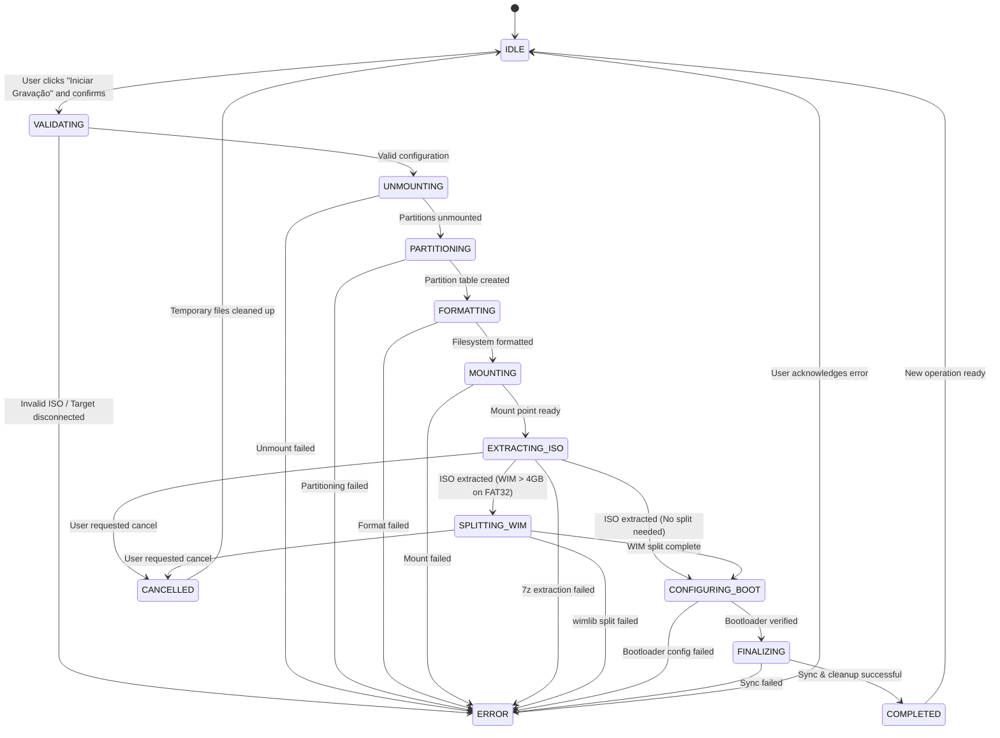

# Data Model: WoeUSB GUI Flasher

**Feature**: WoeUSB GUI Flasher (`001-woeusb-gui`)  
**Status**: Completed  
**Date**: 2026-10-10  

---

## 1. Domain Entities & Value Objects

### 1.1 StorageDevice
Represents a block storage device detected on the Linux host system.

| Field | Type | Required | Description |
| :--- | :--- | :---: | :--- |
| `name` | `str` | Yes | Device kernel identifier (e.g. `"sdd"`, `"sde"`). |
| `path` | `str` | Yes | Absolute device path in `/dev` (e.g. `"/dev/sdd"`). |
| `size_bytes` | `int` | Yes | Raw capacity in bytes. Must be > 2,000,000,000 (2 GB). |
| `size_human` | `str` | Yes | Human-formatted capacity (e.g. `"14.5 GB"`, `"28.8 GB"`). |
| `vendor` | `str` | No | Drive manufacturer (e.g. `"SanDisk"`, `"Kingston"`). |
| `model` | `str` | No | Drive model name (e.g. `"Ultra USB 3.0"`). |
| `is_removable` | `bool` | Yes | Flag indicating whether media is removable (`RM=true` or `TRAN=usb`). |
| `is_system_drive` | `bool` | Yes | Safety flag: `True` if device or its partitions mount `/`, `/boot`, `/home`, etc. |
| `mount_points` | `list[str]` | Yes | Active mount points associated with this device or its partitions. |
| `partitions` | `list[str]` | Yes | Partition identifiers belonging to this device (e.g. `["/dev/sdd1"]`). |

**Validation Rules**:
- A device MUST only be selectable if `is_removable == True` AND `is_system_drive == False`.
- `size_bytes` must be sufficient to hold the target Windows installation (typically >= 8 GB for Windows 10/11).

---

### 1.2 WindowsISO
Represents a Windows installer disk image file.

| Field | Type | Required | Description |
| :--- | :--- | :---: | :--- |
| `file_path` | `Path` | Yes | Absolute filesystem path to the `.iso` file. |
| `file_name` | `str` | Yes | Base filename (e.g. `"Win11_23H2_Portuguese_x64.iso"`). |
| `size_bytes` | `int` | Yes | File size in bytes. |
| `size_human` | `str` | Yes | Human-formatted size (e.g. `"5.12 GB"`). |
| `has_install_wim` | `bool` | Yes | Indicates if `sources/install.wim` exists inside the ISO. |
| `has_install_esd` | `bool` | Yes | Indicates if `sources/install.esd` exists inside the ISO. |
| `install_image_size` | `int` | Yes | Size in bytes of the main installer archive (`install.wim`/`esd`). |
| `requires_split` | `bool` | Yes | `True` if `install_image_size > 4,294,967,295` (4 GB) and target is FAT32. |
| `is_valid` | `bool` | Yes | Whether the ISO passed basic signature validation. |

**Validation Rules**:
- `file_path` must exist, be a readable regular file, and end with `.iso` (case-insensitive).
- Must contain Windows installation structure (`/sources/install.wim` or `/sources/install.esd` and `/bootmgr` or `/efi`).

---

### 1.3 Enums & Configurations

#### `FileSystemType` (Enum)
- `FAT32`: Standard FAT32 filesystem (`vfat`). Supports UEFI Secure Boot natively across all hardware. Requires WIM split if `install.wim > 4 GB`.
- `NTFS`: Windows NT Filesystem. Supports files > 4 GB without splitting, but requires UEFI NTFS driver on certain motherboards.

#### `BootMode` (Enum)
- `UEFI_AND_LEGACY`: Partitioned with MBR partition table, FAT32 partition, and boot flag. Supports both UEFI and Legacy BIOS.
- `UEFI_ONLY`: GPT partition table with EFI System Partition.

#### `BurnConfiguration`
| Field | Type | Default | Description |
| :--- | :--- | :--- | :--- |
| `iso` | `WindowsISO` | *(required)* | Source Windows ISO. |
| `target_device` | `StorageDevice` | *(required)* | Destination USB storage device. |
| `filesystem` | `FileSystemType` | `FileSystemType.FAT32` | Target filesystem. |
| `boot_mode` | `BootMode` | `BootMode.UEFI_AND_LEGACY` | Bootloader setup strategy. |
| `label` | `str` | `"WININSTALL"` | Filesystem volume label. |

---

## 2. Operation State & Lifecycle

### 2.1 `BurnStage` (Enum)
1. `IDLE`: No operation in progress.
2. `VALIDATING`: Checking ISO contents, file hashes, and target device eligibility.
3. `UNMOUNTING`: Unmounting existing active partitions on the device via UDisks2.
4. `PARTITIONING`: Writing partition table (MBR) and creating primary partition.
5. `FORMATTING`: Formatting the partition with the chosen filesystem (`FAT32` / `NTFS`).
6. `MOUNTING`: Mounting target filesystem into `/run/media` via UDisks2.
7. `EXTRACTING_ISO`: User-space extraction of ISO files using `7z`.
8. `SPLITTING_WIM`: Splitting `install.wim` into `.swm` parts via `wimlib-imagex` if needed.
9. `CONFIGURING_BOOT`: Setting active boot flags and verifying UEFI boot loader paths (`/efi/boot/bootx64.efi`).
10. `FINALIZING`: Flushing kernel buffers via `sync` and safely unmounting.
11. `COMPLETED`: Success state.
12. `ERROR`: Operation halted due to failure.
13. `CANCELLED`: Operation halted by user request and resources cleaned up.

---

### 2.2 `BurnOperationState`
| Field | Type | Description |
| :--- | :--- | :--- |
| `stage` | `BurnStage` | Current lifecycle stage. |
| `stage_description` | `str` | Friendly localized text (e.g. `"Extraindo arquivos da imagem ISO..."`). |
| `progress_percent` | `float` | Percentage completion (0.0 to 100.0). |
| `bytes_written` | `int` | Total bytes written so far. |
| `total_bytes` | `int` | Expected total bytes to write. |
| `transfer_speed` | `str` | Instantaneous write speed (e.g. `"24.5 MB/s"`). |
| `elapsed_seconds` | `int` | Total elapsed time in seconds. |
| `is_running` | `bool` | Whether an operation is currently active. |
| `error_message` | `str | None` | Description of error if `stage == ERROR`. |

---

## 3. State Transition Diagram

