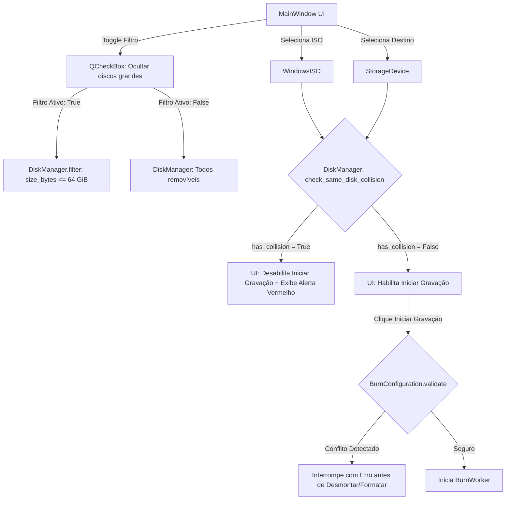

# Data Model: Filtro de Dispositivos Grandes e Prevenção de Conflito de Disco

**Feature**: `002-device-safety-filters`  
**Date**: 2026-10-10  
**Status**: Ready  

---

## 1. Entidades de Domínio

### 1.1 StorageDevice (Atualizado)

Representa uma unidade de armazenamento de bloco detectada pelo sistema operacional.

| Campo | Tipo | Descrição | Regras de Validação |
|-------|------|-----------|---------------------|
| `name` | `str` | Nome base do dispositivo (ex.: `"sdd"`) | Não vazio |
| `path` | `str` | Caminho do nó de bloco (ex.: `"/dev/sdd"`) | Deve iniciar com `"/dev/"` |
| `size_bytes` | `int` | Tamanho total em bytes | Inteiro $\ge 0$ |
| `size_human` | `str` | Tamanho formatado amigável (ex.: `"14.5 GB"`) | String não vazia |
| `vendor` | `str` | Fabricante (ex.: `"Netac"`) | Opcional |
| `model` | `str` | Modelo (ex.: `"OnlyDisk"`) | Opcional |
| `is_removable` | `bool` | Se o dispositivo é removível / USB | Booleano |
| `is_system_drive`| `bool` | Se contém partições de SO raiz | Booleano |
| `mount_points` | `list[str]` | Pontos de montagem ativos | Lista de caminhos |
| `partitions` | `list[str]` | Caminhos das partições filhas (ex.: `["/dev/sdd1"]`) | Lista de strings |
| **`is_large_drive`** *(novo)* | `bool` | Indica se o dispositivo excede o limiar de 64 GB | Calculado: `size_bytes > MAX_TYPICAL_PENDRIVE_BYTES` |

**Constante de Limiar**:
```python
MAX_TYPICAL_PENDRIVE_BYTES: int = 68_719_476_736  # 64 GiB (68.7 GB)
```

**Métodos de Validação**:
- `is_eligible_target(hide_large_drives: bool = False) -> bool`:
  - Retorna `False` se `is_system_drive` for `True`.
  - Retorna `False` se `not is_removable`.
  - Retorna `False` se `size_bytes < 2_000_000_000` (2 GB).
  - Retorna `False` se `hide_large_drives and self.is_large_drive`.
  - Retorna `False` se qualquer ponto de montagem coincidir com montagens de sistema.
  - Caso contrário, retorna `True`.

---

### 1.2 DiskCollisionCheckResult (Nova Entidade)

Representa o resultado da verificação de conflito físico entre o arquivo ISO de origem e o dispositivo alvo de gravação.

| Campo | Tipo | Descrição |
|-------|------|-----------|
| `has_collision` | `bool` | `True` se a ISO e o dispositivo alvo residem no mesmo disco físico |
| `source_partition` | `str \| None` | Caminho da partição de onde a ISO é lida (ex.: `"/dev/sdc2"`) |
| `source_parent_disk` | `str \| None` | Disco físico pai da partição de origem (ex.: `"/dev/sdc"`) |
| `target_parent_disk` | `str` | Disco físico pai do alvo de gravação (ex.: `"/dev/sdc"`) |
| `message` | `str` | Mensagem descritiva formatada para a UI |

---

### 1.3 BurnConfiguration (Atualizado)

Configuração agregada para a operação de gravação.

| Campo | Tipo | Descrição |
|-------|------|-----------|
| `iso` | `WindowsISO` | Imagem ISO selecionada |
| `target_device` | `StorageDevice` | Dispositivo de destino selecionado |
| `filesystem` | `FileSystemType` | FAT32 ou NTFS |
| `boot_mode` | `BootMode` | Estratégia de bootloader |
| `label` | `str` | Rótulo do volume de destino |

**Regras de Validação no método `validate()`**:
1. Valida elegibilidade básica do `target_device`.
2. Valida existência e legibilidade do arquivo `iso.file_path`.
3. Valida capacidade mínima: `target_device.size_bytes >= iso.size_bytes`.
4. **Nova Validação de Segurança Mandatória**:
   - Executa `DiskManager.check_same_disk_collision(self.iso.file_path, self.target_device)`.
   - Se `result.has_collision` for `True`, levanta `ValueError(result.message)`.

---

## 2. Diagrama de Relacionamento e Fluxo de Validação



